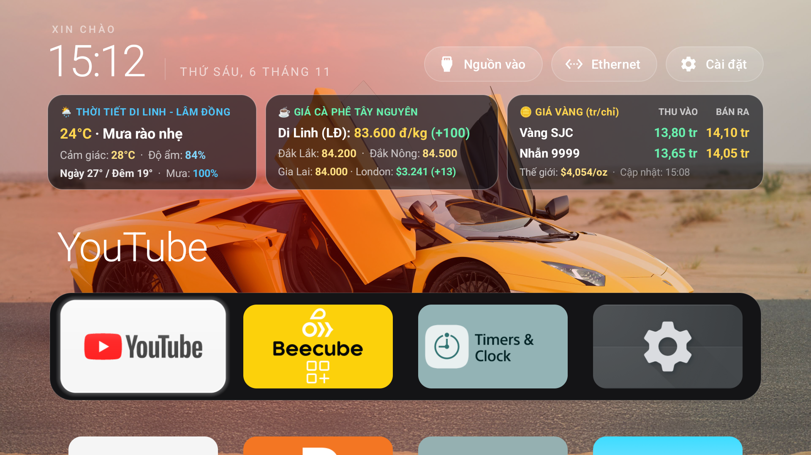
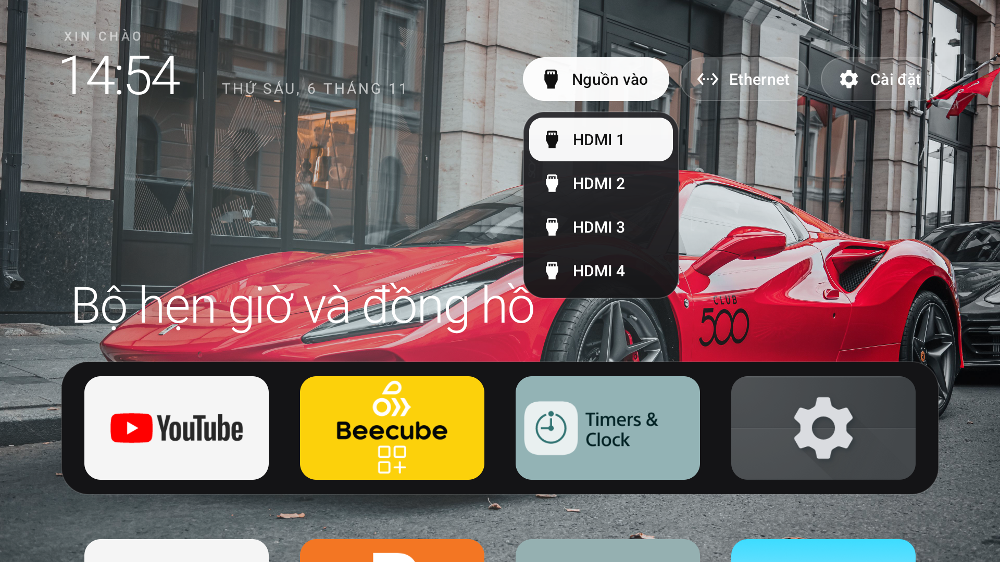
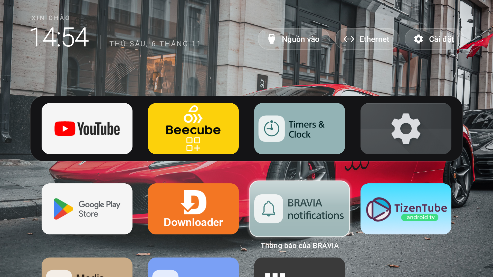

<p align="center">
  
</p>

# 🌲 Clean-DiLinh-TV — Màn hình chính Android TV & Bảng Thời Tiết · Giá Cà Phê · Giá Vàng

**Clean-DiLinh-TV** là phiên bản tuỳ biến dành riêng cho người dùng Việt Nam (đặc biệt tại **Di Linh - Lâm Đồng** và khu vực **Tây Nguyên**), kết hợp màn hình chính **CleanYourTV** siêu nhẹ, không quảng cáo với **bộ 3 bảng thông tin trực tiếp** cập nhật tự động mỗi 15 phút:

1. **🌦️ Bảng 1 (Trái) — Thời Tiết Di Linh - Lâm Đồng (100% Tiếng Việt):**
   - Hiển thị nhiệt độ hiện tại, trạng thái thời tiết tiếng Việt (*Mưa rào nhẹ, Trời quang, Có mây...*), nhiệt độ cảm giác thực, độ ẩm, biên độ nhiệt Ngày/Đêm và xác suất mưa (nguồn: Open-Meteo `11.5815, 108.0764`).
2. **☕ Bảng 2 (Giữa) — Giá Cà Phê Tây Nguyên:**
   - Hiển thị giá cà phê nhân xô trực tiếp tại **Di Linh (Lâm Đồng)** kèm mức tăng/giảm trong ngày, cùng giá tại **Đắk Lắk**, **Đắk Nông**, **Gia Lai** và giá **Robusta sàn London ($/tấn)**.
3. **🪙 Bảng 3 (Phải) — Giá Vàng (tr/chỉ) — Thu Vào & Bán Ra:**
   - Tách riêng 2 cột **THU VÀO** và **BÁN RA** rõ ràng cho **Vàng SJC** và **Vàng Nhẫn 9999**, kèm giá vàng thế giới (`$/oz`) và giờ cập nhật.

### ✨ Điểm nổi bật về hiển thị thông minh
- **Tự động ẩn khi mở menu `Nguồn vào` (HDMI 1–4) hoặc `Cài đặt`:** Không bao giờ che khuất danh sách chọn cổng HDMI hay hộp thoại hệ thống.
- **Gán theo hàng đầu tiên (tự ẩn khi cuộn xuống):** Khi bạn bấm nút **Xuống** trên remote để xem các hàng ứng dụng bên dưới, bộ 3 bảng tự động ẩn đi để không đè lên biểu tượng ứng dụng; khi bấm **Lên** về lại hàng đầu, bảng tự động hiện lại.
- **Tự động xóa khi về màn hình khóa / màn hình chờ đồng hồ (`ClockActivity` / `ClockDream`):** Khi TV nghỉ hoặc bật màn hình khóa đồng hồ, bảng tự động tắt hoàn toàn.

<p align="center">
  
  &nbsp;&nbsp;
  
</p>

> ❤️ **Lời cảm ơn & Tôn trọng bản quyền tác giả:**
> Xin gửi lời cảm ơn chân thành đến tác giả **[Gathin23](https://github.com/Gathin23)** cùng dự án gốc **[CleanYourTV](https://github.com/Gathin23/cleanyourtv)** đã xây dựng và chia sẻ một nền tảng Launcher mã nguồn mở tuyệt vời, gọn nhẹ và hoàn toàn không quảng cáo cho cộng đồng Android TV / Google TV. Phiên bản **Clean-DiLinh-TV** này được phát triển kế thừa trên nền tảng của **Gathin23 — CleanYourTV**.

---

## 🚀 Hướng dẫn cài đặt chi tiết (Ai cũng có thể tự làm theo)

Bạn có thể chọn **1 trong 2 cách** dưới đây:
- **Cách 1 (Khuyên dùng — Nhanh nhất, chỉ 2 phút):** Cài đặt trực tiếp file APK dựng sẵn [`releases/tv-market-widget-dilinh.apk`](releases/tv-market-widget-dilinh.apk) lên TV đang chạy CleanYourTV mà **không cần xóa hay cài lại launcher**.
- **Cách 2:** Cài đặt trọn bộ từ đầu (dọn ứng dụng rác + cài đặt Launcher Clean-DiLinh-TV từ mã nguồn).

---

### Bước chuẩn bị chung: Bật Gỡ lỗi USB (ADB qua Wi-Fi) trên TV

1. Trên TV, vào **Cài đặt (Settings) → Hệ thống (hoặc Tuỳ chọn thiết bị) → Giới thiệu (About)**.
2. Kéo xuống mục **Bản dựng (Build)** và bấm nút **OK** trên điều khiển **7 lần liên tiếp** cho đến khi TV báo *"Bạn đã là nhà phát triển"*.
3. Bấm nút **Quay lại (Back)**, vào mục **Tuỳ chọn nhà phát triển (Developer options)** vừa xuất hiện:
   - Bật **Gỡ lỗi USB (USB debugging)**.
   - Nếu có mục **Gỡ lỗi qua mạng (Network debugging)** thì bật luôn.
4. Xem địa chỉ IP Wi-Fi/Mạng dây của TV tại **Cài đặt → Mạng và Internet** (ví dụ: `192.168.1.4`).

---

### Cách 1: Cài đặt nhanh bộ 3 bảng lên TV bằng file APK dựng sẵn

Trong thư mục [`releases/tv-market-widget-dilinh.apk`](releases/tv-market-widget-dilinh.apk) đã có sẵn file APK biên dịch hoàn chỉnh.

#### Chạy lệnh từ máy tính Windows (cùng mạng Wi-Fi với TV):

1. Tải kho lưu trữ này về máy tính (hoặc tải riêng file [`releases/tv-market-widget-dilinh.apk`](releases/tv-market-widget-dilinh.apk)).
2. Mở **PowerShell** hoặc **Command Prompt (CMD)** tại thư mục chứa file APK, thay `192.168.1.4` bằng địa chỉ IP TV của bạn rồi chạy lần lượt các lệnh sau:

```powershell
# 1. Kết nối ADB tới TV (Bấm "Cho phép / Allow" trên màn hình TV nếu được hỏi)
adb connect 192.168.1.4:5555

# 2. Cài đặt file APK bộ 3 bảng Thời tiết - Cà phê - Giá vàng
adb install -r releases\tv-market-widget-dilinh.apk

# 3. Cấp quyền hiển thị trên màn hình chính và bật tự động chạy
adb shell appops set com.antigravity.tvmarket SYSTEM_ALERT_WINDOW allow
adb shell settings put secure enabled_accessibility_services com.antigravity.tvmarket/com.antigravity.tvmarket.MarketWidgetService
adb shell settings put secure accessibility_enabled 1

# 4. Kích hoạt cập nhật dữ liệu trực tiếp ngay lập tức
adb shell am broadcast -a com.antigravity.tvmarket.UPDATE_WIDGET --ez fetch_now true
```

> **Mẹo nếu không dùng máy tính:** Bạn có thể chép file `releases/tv-market-widget-dilinh.apk` vào USB (hoặc tải qua ứng dụng **Downloader** trên TV), mở file để cài đặt, sau đó mở ứng dụng **TV Market Widget** trên TV → bấm cấp quyền **Hiển thị trên ứng dụng khác** và bật **Trợ năng (Accessibility) → TV Market Widget** là xong!

---

### Cách 2: Cài đặt trọn bộ Launcher Clean-DiLinh-TV & Dọn rác TV từ đầu

Nếu TV của bạn vẫn đang chạy giao diện Google TV / Android TV gốc nặng nề và nhiều quảng cáo, bạn có thể cài đặt trọn bộ Launcher **Clean-DiLinh-TV** (đã tích hợp sẵn [`DiLinhMarketPanel.java`](launcher/app/src/main/java/com/gathin/tvhome/DiLinhMarketPanel.java) bên trong mã nguồn Launcher).

#### 1. Trên Windows (PowerShell):

Cài đặt **Python 3** và **Android Studio** (có sẵn JDK & Android SDK Platform 34), sau đó mở PowerShell tại thư mục gốc của repo:

```powershell
# Tạo môi trường Python cho bộ công cụ kết nối TV
python -m venv tools\venv
tools\venv\Scripts\python.exe -m pip install -r tools\requirements.txt

# Build và cài đặt Launcher Clean-DiLinh-TV lên TV (thay 192.168.1.4 bằng IP của TV)
powershell -ExecutionPolicy Bypass -File launcher\build-and-install.ps1 -TvHost 192.168.1.4
```

#### 2. Trên macOS / Linux:

```bash
python3 -m venv tools/venv
tools/venv/bin/pip install -r tools/requirements.txt

# Build và cài đặt Launcher lên TV
TV_HOST=192.168.1.4 launcher/build-and-install.sh
```

> Muốn giữ launcher gốc vẫn bật song song, thêm `-StockLauncher none` (trên Windows) hoặc `STOCK_LAUNCHER=none` (trên macOS/Linux).

---

## 🛠️ Cách tự đổi sang Tỉnh / Thành phố khác (nếu bạn không ở Di Linh)

Nếu bạn muốn đổi bảng thời tiết sang khu vực khác ngoài Di Linh - Lâm Đồng:
1. Mở file [`addons/tv-market-widget/app/src/main/java/com/antigravity/tvmarket/MarketFetcher.java`](addons/tv-market-widget/app/src/main/java/com/antigravity/tvmarket/MarketFetcher.java) (hoặc [`DiLinhMarketPanel.java`](launcher/app/src/main/java/com/gathin/tvhome/DiLinhMarketPanel.java)).
2. Thay toạ độ `latitude=11.5815&longitude=108.0764` bằng vĩ độ và kinh độ nơi bạn ở (ví dụ Bảo Lộc: `11.5479, 107.8077`; Đà Lạt: `11.9404, 108.4583`; Buôn Ma Thuột: `12.6667, 108.0500`).
3. Biên dịch lại APK bằng lệnh:
   ```powershell
   cd addons\tv-market-widget
   .\gradlew.bat assembleRelease
   ```

---

## 📺 Tính năng của Launcher CleanYourTV

- **Màn hình chính tối giản**: Nền tối sang trọng hoặc hình nền tuỳ chọn, mặc định 4 ứng dụng hay dùng trên thanh dock phía dưới.
- **Tên ứng dụng đang chọn**: Hiện tên ứng dụng chữ lớn kèm hiệu ứng ánh sáng nền lấy từ màu biểu tượng ứng dụng.
- **Lưới ứng dụng**: Bấm nút **Xuống** để xem thêm ứng dụng (hỗ trợ 4, 5, 6 hoặc 7 cột mỗi hàng).
- **Sắp xếp bằng điều khiển**: Giữ nút **OK** trên mục **Cài đặt** để mở menu và vào chế độ sắp xếp vị trí ứng dụng.
- **Lối tắt nhanh**: **Nguồn vào (HDMI 1–4)**, **Wi-Fi / Ethernet** và **Cài đặt** ở góc trên bên phải.
- **Đồng hồ và trình bảo vệ màn hình**: Lời chào tiếng Việt, đồng hồ, ngày tháng và màn hình chờ đồng hồ tối giản.

### Chỉnh cài đặt ngay trên TV

Bấm nút **Cài đặt** trên màn hình chính để mở cài đặt hệ thống của TV. **Giữ nút OK trên điều khiển khi đang chọn nút Cài đặt** để mở menu cài đặt riêng của Launcher:

| Mục | Tác dụng |
|---|---|
| **Số ứng dụng mỗi hàng** | Chọn 4, 5, 6 hoặc 7 cột. |
| **Hiệu ứng chuyển động** | Bật hoặc tắt hiệu ứng chuyển cảnh mượt của launcher. |
| **Hiệu ứng nâng cao** | Ô nhấc lên, icon phóng to, màu nền chuyển mượt hơn. |
| **Theo theme (xoá cài đặt trên TV)** | Quay về cấu hình của theme hiện tại hoặc cấu hình gốc. |
| **Lối vào màn hình chính mặc định** | Mở trang chọn màn hình chính của Android để chuyển đổi giữa các launcher. |

### Đổi hình nền và Theme

Bạn có thể áp dụng các bộ giao diện (theme) có sẵn trong thư mục [`themes/`](themes/README.md) hoặc tự đặt hình nền riêng:

```bash
# Áp dụng theme mẫu
TV_HOST=192.168.1.4 tools/theme.sh themes/aurora

# Quay về giao diện mặc định
TV_HOST=192.168.1.4 tools/theme.sh --reset
```

---

## 🔄 Khôi phục về trạng thái gốc (Hoàn tác)

Nếu bạn đã dùng công cụ tắt ứng dụng rác (`tools/disable.sh` hoặc `tools/disable.ps1`), bản ghi trạng thái ban đầu luôn được lưu tự động trong `~/.cleanyourtv/` trên máy tính. Để khôi phục lại toàn bộ ứng dụng và màn hình chính gốc:

```bash
TV_HOST=192.168.1.4 tools/restore.sh examples/ten-model-tv/debloat.txt
```

Nếu chỉ muốn gỡ bỏ bảng **Thời tiết · Giá Cà phê · Giá Vàng** khỏi TV bất kỳ lúc nào, bạn chỉ cần chạy:

```powershell
adb uninstall com.antigravity.tvmarket
```

---

## 📄 Giấy phép

Dự án phát hành theo [giấy phép MIT](LICENSE), phát triển dựa trên nền tảng [CleanYourTV](https://github.com/Gathin23/cleanyourtv). Font chữ Outfit sử dụng [SIL Open Font License](launcher/FONT-LICENSE-OFL.txt).
